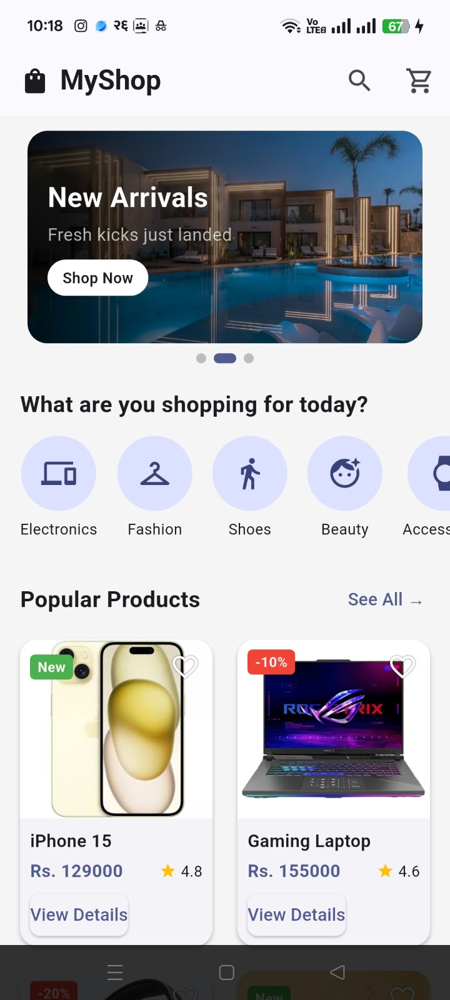
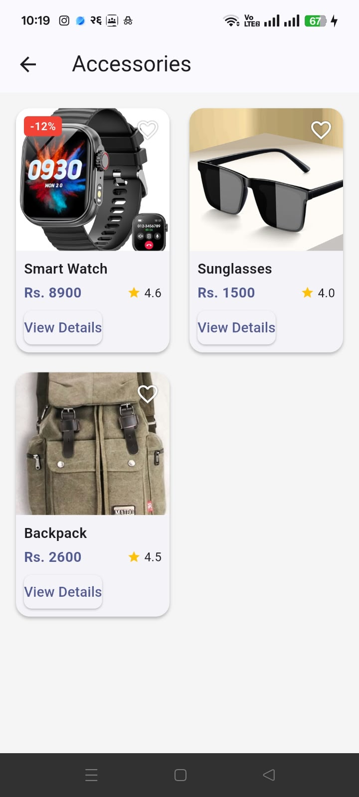
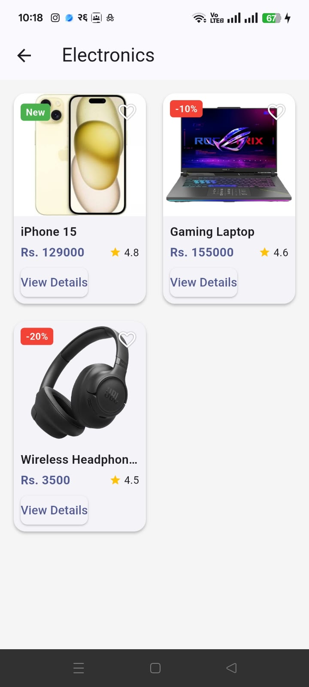
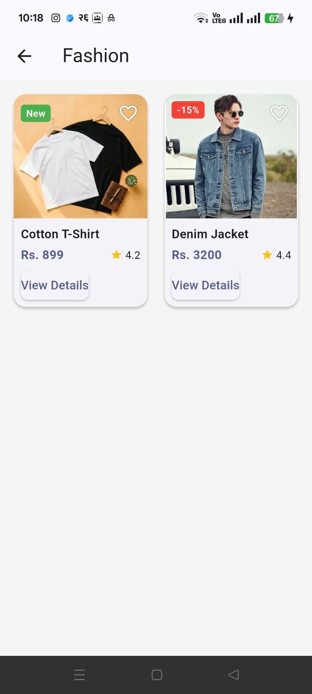
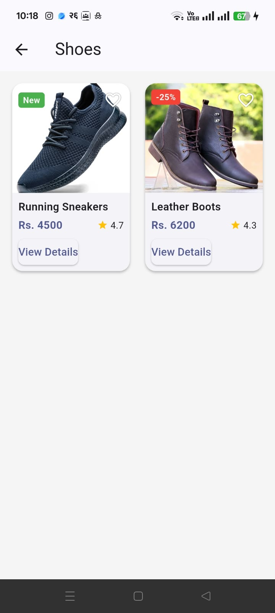

# MyShop - Mini E-Commerce App
Name : Pratik Pariyar
ID : 2510412149
Course : Mobile Application Development

# Description
MyShop is a simple multi-screen shopping app which is built with flutter using static local data. 
Users browse promotional banners, categories and products, and open product details.

# Features
- Home page with AppBar (logo, search, cart), banner carousel, horizontal categories, popular products.
- Category page with 'GridView.builder' and product filtering
- Product details page (image, name, price, rating, category, description, Add to Cart SnackBar)

# Screenshots

# Categories

# Product Details

# Packages Used
* carousel slider - It is an auto playing promotional banner carousel
[README.md](README.md)
# How to run
- Download the folder
- Unzip it in a specific location
- Open the folder from Android Studio
- Go to the terminal of Android Studio
- Then run 'flutter pub get'
- Then run 'flutter run'
